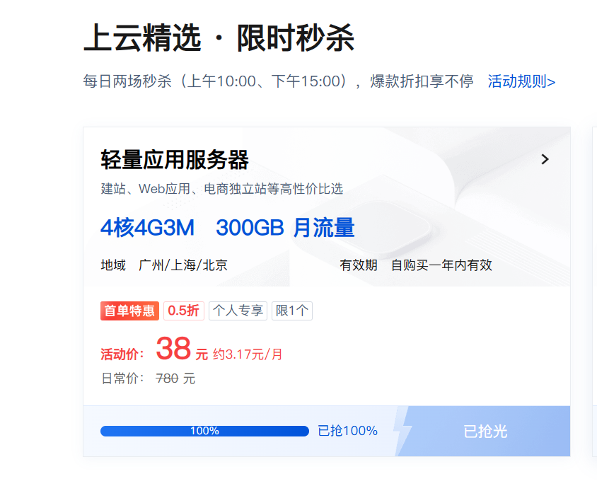

# 腾讯云轻量应用服务器 · 限时秒杀助手

在腾讯云活动页上盯着那张「秒杀的服务器」卡片，按钮一变成「立即抢购」就点下去、把购买弹窗确认掉，**剩下的付款由你自己在浏览器里完成**。



> ⚠️ **先说清楚三件事**
>
> 1. **脚本不碰支付。** 它只做到「确认购买」，收银台留给你。
> 2. **不保证成功。** 结果取决于库存、账号资格、网络和腾讯云的风控。
> 3. **请遵守活动规则。** 脚本不改变你在活动里的资格和价格，只是替你盯着按钮。请自己核对订单的规格、地域、镜像、价格和有效期。

---

## 目录

- [它做什么](#它做什么)
- [为什么必须用浏览器](#为什么必须用浏览器)
- [快速开始](#快速开始)
- [配置](#配置)
- [日志怎么看](#日志怎么看)
- [离线自测](#离线自测)
- [工作原理](#工作原理)
- [常见问题](#常见问题)
- [参考与致谢](#参考与致谢)
- [许可](#许可)

---

## 它做什么

```
扫码登录 → 打开活动页 → 读出页面上的秒杀时间表
        → 滚到目标模块（卡片在滚到之前只是空骨架，扫不到）
        → 锁定目标按钮（规格 + 价格两条一起判，价格才是关键）
        → 按钮从「添加提醒」翻成「立即抢购」的那一刻点下去
        → 按内容认出购买弹窗 → 选地域 → 点「确认购买」
        → 订单生成，浏览器不关，你来付款
```

三个关键点，都是踩过坑才定下来的：

| 坑 | 做法 |
| --- | --- |
| 同一款配置在页面上有好几张卡，价格不同 | **规格 + 价格两条一起判**，价格才是决定性的那张 |
| 卡片在滚到屏幕里之前是空骨架，按钮里没有文字 | 先把模块滚进视口再扫，中途不换目标 |
| 弹窗的 class 名没人知道，页面上还到处是「确定」 | 弹窗**按内容**认（写着我们的商品 **且** 带确认按钮），整屏遮罩一律排除；确认词按优先级取，`立即支付` / `去支付` 永远不点 |

---

## 为什么必须用浏览器

很多「秒杀脚本」是直接调接口的。这条路在当前活动上行不通：

页面发出去的购买请求是**带签名**的——签名里混进了服务器时间、请求体、User-Agent 和 skey cookie，由前端请求层算出来。手写的 HTTP 请求复现不出这个签名，会被服务端拒掉。

所以这里换了个思路：**让真实页面自己发请求、自己签名**。脚本只负责找到那个按钮、在正确的那一刻点下去。页面签好的请求就是最正的那一个。

---

## 快速开始

### 0. 环境要求

- Python 3.8+
- 一台能上网的电脑
- 一个符合活动资格并已实名的腾讯云账号
- 一部能扫码的手机

### 1. 装依赖（只做一次）

```powershell
git clone https://github.com/nineanswerer/tenxunyun.git
cd tenxunyun

py -m venv .venv
.\.venv\Scripts\python.exe -m pip install -r requirements.txt
.\.venv\Scripts\python.exe -m playwright install chromium
```

> **永远用 `.\.venv\Scripts\python.exe` 调脚本，不要用裸 `python`。** 缺依赖、版本不对都会出奇奇怪的问题。

macOS / Linux 把路径换成 `.venv/bin/python` 即可。

### 2. 扫码登录

```powershell
.\.venv\Scripts\python.exe snap_login.py
```

浏览器会自己打开登录页。**用手机扫二维码并在手机上确认**，等 8 秒左右，浏览器关闭，目录里出现 `cookies.json`。

`cookies.json` 就是你的登录凭据，**别发给别人、别提交到 git**（`.gitignore` 已经挡住了）。Cookie 会过期，每场活动前重做一次。

### 3. 改配置

第一次运行时 `config.json` 会自动从 `config.example.json` 复制一份。打开它，把这几项改成你这次要的：

```json
{
  "page_url": "https://cloud.tencent.com/act/pro/featured-202607",
  "spec": "4核4G",
  "marker": "300GB",
  "price": "38",
  "seckill_title": "限时秒杀",
  "act_id": "1996855673581677",
  "regions": ["广州", "上海", "北京"]
}
```

不知道怎么填？见下面的[配置](#配置)一节，或者先跑一次 `--survey` 看页面上都有什么。

### 4. 挂上，等

```powershell
# 先只看不点：把页面上所有候选卡片扫一遍
.\.venv\Scripts\python.exe snap_browser.py --survey

# 正式跑
.\.venv\Scripts\python.exe snap_browser.py
```

**提前 5–10 分钟启动**，然后：

- **浏览器窗口要留在屏幕上，不能最小化。** 最小化 / 切到后台标签页会被浏览器降频，页面自己的状态轮询就慢了，按钮翻不过来。
- 终端会打印下一场还有多少分钟，然后静静等着。
- 脚本会把目标按钮框成粉色描边——**你能在浏览器里看到它盯的是哪一张卡**。
- 开抢那一刻它会点下去、确认弹窗，然后**把浏览器留着不动**。该你上场了。

---

## 配置

`config.json`（从 `config.example.json` 自动复制，已被 git 忽略）：

| 键 | 说明 | 例子 |
| --- | --- | --- |
| `page_url` | 活动页地址 | `https://cloud.tencent.com/act/pro/featured-202607` |
| `spec` | 卡片上印的规格，**定位的第一条依据** | `4核4G` |
| `marker` | 卡片上另一条必须出现的字（流量、内存…） | `300GB` |
| `price` | 秒杀价，单位元，**定位的第二条依据** | `38` |
| `seckill_title` | 秒杀模块标题里的关键词 | `限时秒杀` |
| `act_id` | 这个商品的商品 id，页面的 `__NEXT_DATA__` 里能查到 | `1996855673581677` |
| `regions` | 卡片提供的地域，按优先级排列 | `["广州","上海","北京"]` |
| `dialog_markers` | 额外用来认弹窗的字（规格、价格会自动带上） | `[]` |
| `cookie_file` | Cookie 文件名 | `cookies.json` |
| `log_file` | 日志文件名 | `snap_browser.log` |

**`price` 为什么这么重要**：页面上常常有同规格、不同价格的卡片（秒杀的那张 38 元，别处的 109 元，还有活动价 138 元那种）。光看规格会挑错，光看价格也可能挑错——所以两条一起判，价格优先。

**`price` 只认整数**：脚本会拿 `38` 去匹配 `38元` 和 `¥38`，但**不会**把 `138元` 或 `388元` 当成 `38元`。

**`act_id` 在哪找**：活动页的 `__NEXT_DATA__` → `props.pageProps.activityData` → `twoDaySeckillState.flashResult[日期][场次].sales[].act_id`。想省事就先不管它——它只影响日志里「哪一场是我们要的」那几行，不影响点按钮。

---

## 日志怎么看

日志同时打在终端和 `snap_browser.log` 里，每行长这样：

```text
[10:00:03] FIRE  attempt 1: '立即抢购' -- clicking
```

| 标签 | 意思 | 正常的样子 |
| --- | --- | --- |
| `START` | 启动，带版本号、Cookie 数量和当前目标 | `b5: ... cookies: 31` |
| `NAV` | 实际打开的网址 | 活动页地址 |
| `SCHED` | 页面上有几场秒杀、每场几点、下一场还剩几分钟 | `next: 2026-10-26 10:00:00-12:00:00 未开始 (opens in 812.3 min)` |
| `CARD` | 扫到的候选卡片，哪张是目标 | `38元 btn='添加提醒' score=7 ...` |
| `TARGET` | 锁定了哪个按钮 | `button '添加提醒' top=...` |
| `WAIT` | 等待中 | `waiting for the button to say 立即抢购` |
| `BTN` | 目标按钮当前文字（变了才打印） | `target button = '立即抢购'` |
| `FIRE` | 开火：点了按钮 / 点了确认 | `clicked; hunting for the buy dialog` |
| `DIALOG` | 弹窗长什么样、点了哪个键 | `our dialog 520x300 ...` / `clicked '确认购买' in our dialog` |
| `RES` | 关键接口的返回状态 | `200 .../dianshi/do-goods` |
| `STATE` | 按钮变成「已抢光」之类的状态 | `the 38元 card says '已抢光'` |
| `HOLD` | **脚本主动停手了，接下来归你** | 见[常见问题](#常见问题) |
| `NEXT` | 订单成了，浏览器留着 | `browser stays open -- pay in this window` |

日志里**只有请求方法、路径和请求体的字段名**，没有请求头、没有 Cookie、没有响应体。

---

## 离线自测

两个测试都只打开**本地合成页面**，不联网、不碰账号、不下单：

```powershell
.\.venv\Scripts\python.exe test_snap_target.py   # 定位规则
.\.venv\Scripts\python.exe test_dialog.py        # 购买弹窗
```

末行都是 `all checks passed` 就说明环境没坏。

`test_snap_target.py` 会造一个带各种陷阱的假页面：同规格但价格不同的卡、还没渲染出来的骨架卡、价格里**包含**我们价格的那张（`138元` vs `38元`）、长得像按钮的进度条，然后检查定位规则挑中的正是我们那张。

`test_dialog.py` 造一个带整屏遮罩、促销横幅、页脚杂散「确定」、别家商品的弹窗的假页面，然后检查：

- 弹窗是**按内容**认出来的；
- 地域是从**同一个弹窗里**选的；
- 确认键是弹窗自己的「确认购买」，**页脚那个「确定」没被点**；
- 认不出 class 时，退路只会点页面上**唯一**的「确认购买」。

---

## 工作原理

### 定位规则

页面上每个商品组是一个模块：

```
div.qc-base-module.uno3-buy-card-wrap
  ├── div.uno3-buy-card-tab            (每个变体一个 tab)
  │     └── div.uno3-buy-card-tab-item-text   "轻量应用服务器 4核4G3M"
  └── div.qc-base-grid__row            (每个变体一张卡)
        └── div.uno3-buy-card.uno3-buy-card-normal
              └── div.uno3-buy-card__btn   添加提醒 / 立即抢购 / 已抢光
```

规则：

1. 候选是 `[class*=buy-card__btn]:not([class*=progress])` 且按钮文字非空（骨架卡没有文字，自然被排除）；
2. 往上找到最近的那张商品卡，卡片文字必须**包含 `spec`**（或 `marker`）；
3. 卡片文字还必须**匹配 `price`**；有匹配的就只在这些里面挑；
4. 打分排序取最高的那个：命中规格 +4，tab 顺序对得上 +3，命中 marker +2，命中价格 +1。

> **模块的 tab 栏里写的可能是商品名，不是规格。** 秒杀模块的 tab 是「轻量应用服务器 | 轻量对象存储 | 企业网盘 | 云开发 CloudBase」——只按 tab 找规格是找不到它的。所以脚本把页面上所有模块列出来，秒杀模块排第一，一个一个滚过去扫。

### 购买弹窗

弹窗的 class 名没人知道（页面每次改版都会换），所以选择器故意写得很宽，认它的办法是**内容**：

1. 找一个看得见的面板，它**写着我们的商品**（规格 / 流量 / 价格任一命中）**并且带一个确认按钮**；
2. **占满 80% 视口的整屏遮罩一律排除**——遮罩里装着商品卡片，还可能带一个无关的「确定」，点它就会把弹窗关掉（这正是第一次尝试失败的原因）；
3. 剩下的里面**最小的那个**是弹窗，给它打上标记 `data-snap-dlg`；
4. **选地域**和**点确认**是分开两步：选地域会重绘弹窗，一起点会点到已经失效的按钮；
5. 确认词按优先级取：`确认购买 → 确认下单 → 提交订单 → 去支付 → 立即支付 → 确定 → 确认`。`立即购买` 被**排除**——那是页面上别的卡片的按钮文字；
6. 实在认不出 class 时，退路是找 `确认购买` 这类下单词，且**页面上只能有一个**才点；`立即支付` / `去支付` 永远不点（那是付款），`确定` / `确认` 满页都是，也不点。

### 时机

页面每约 13 秒自己轮询一次秒杀状态，按钮是自己从「添加提醒」翻成「立即抢购」的——**脚本不刷新页面**，所以页面不会在你眼前跳来跳去。脚本每 80 毫秒读一次按钮文字，一变就点。

---

## 常见问题

| 现象 | 多半是 | 怎么办 |
| --- | --- | --- |
| `ModuleNotFoundError: No module named 'playwright'` | 用错了解释器 | 全部改成 `.\.venv\Scripts\python.exe` |
| 提示没有 `cookies.json` | 没登录 | 先跑 `snap_login.py` |
| 扫码后浏览器没关 | 手机上还没点确认 | 手机上确认，等 8 秒；实在不行关掉重跑 |
| 日志里没有 `SCHED` | 页面没加载出来 | 看 `NAV` 那行是什么网址；刷新重试 |
| 一直 `WAIT` 不 `FIRE` | 按钮没翻成「立即抢购」——**这通常是好消息，说明已经抢光了** | 看 `BTN` 行：「已抢光」就是没了，「添加提醒」说明还没开始 |
| `FIRE` 了但没有 `DIALOG` | 弹窗没开，或开在别的标签页 | 看有没有新标签页弹出来 |
| `DIALOG` 找到了但没点成 | 弹窗结构跟预期不一样 | 把 `snap_browser.log` 里 `DIALOG` 那几行发出来，照着改 `snap_browser.py` 的 `DIALOG_CONFIRM_JS` |
| 出现 `HOLD` | 脚本连点几次没成，主动让位 | **你在浏览器里自己点**：找到目标卡 → 点「立即抢购」→ 弹窗里点「确认购买」→ 付款 |
| 终端里中文乱码 | 少了 `PYTHONUTF8=1` | 用 `.\.venv\Scripts\python.exe` 调就没问题（脚本自己设了） |
| 选不中地域 | 弹窗结构变了 | 改 `snap_browser.py` 的 `DIALOG_REGION_JS` |

**任何时候你都可以直接接管。** 脚本打出 `HOLD` 之后只打印日志、不再碰页面；就算它还在跑，你手动点也一样——下单请求是页面自己签名发出的，脚本在旁边看着。

---

## 参考与致谢

- 思路参考了微信公众号 **「ttj的公众号」** 的文章《腾讯云服务器抢购技巧》：
  <https://mp.weixin.qq.com/s/gXDODqg6Q3vU9WAvionnUQ>
- 页面结构、时间表、签名机制都是照着**活动页自己的代码和 `__NEXT_DATA__`** 摸出来的。

本项目与腾讯云无关，也没有得到腾讯云的任何认可或背书。

---

## 许可

MIT，见 [LICENSE](LICENSE)。

---

**免责**：本项目仅用于个人学习和自动化流程研究，不提供任何抢购成功保证。使用者应自行核对商品参数、价格、地域、镜像、账号资格和活动规则，并自行承担运行脚本、生成订单、账号风控或其他后果。
